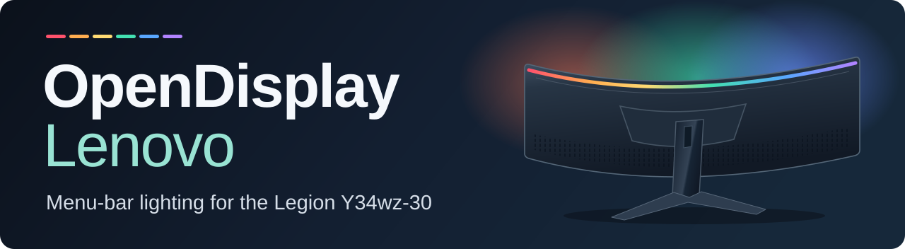
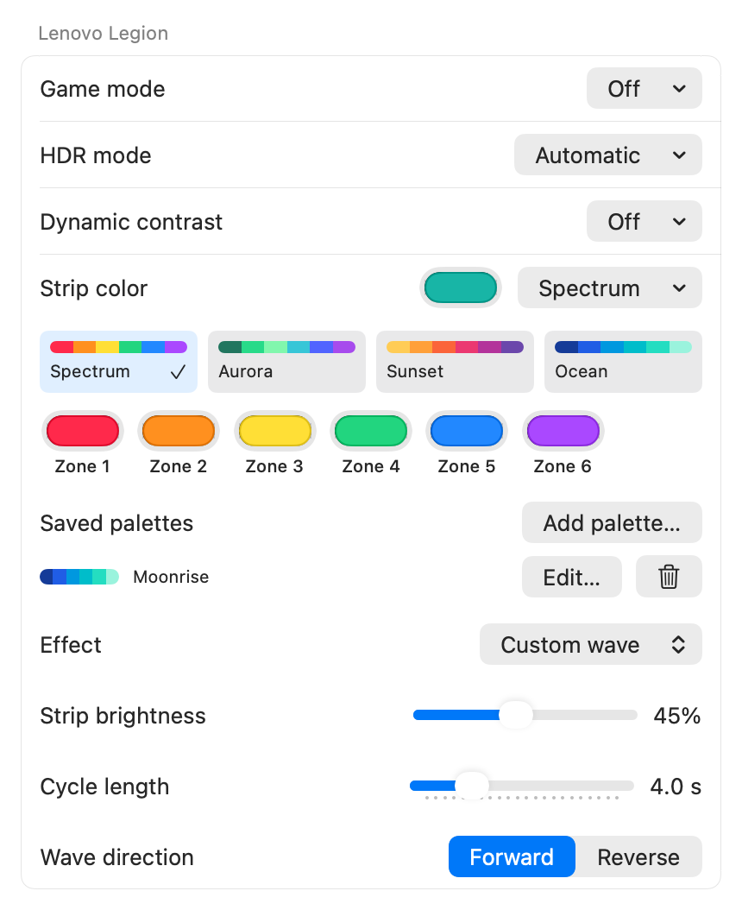

<h1></h1>

[](#install-on-your-mac) [](#install-on-your-mac) [](https://github.com/aquitaine/OpenDisplay/tree/v0.11.8) [](LICENSE)

**Change the light behind your Lenovo Legion Y34wz-30 from the Mac menu bar.** Click a swatch for any color, give six zones different colors, or let the strip move with your music. This personal fork brings controls from Lenovo’s Windows utility into OpenDisplay alongside display brightness and volume.

[Install on your Mac](#install-on-your-mac) · [Connect the monitor](#connect-the-monitor) · [Troubleshooting](#troubleshooting)

<a href="Docs/images/lenovo-color-picker.png"></a> <a href="Docs/images/lenovo-settings.png"></a>

*The Displays menu and the Lenovo Legion settings card, shown with sample settings. Click either screenshot to enlarge it.*

## Install on your Mac

You’ll need an **Apple Silicon Mac** (M-series), **macOS 14 or later**, **Homebrew**, and the **full Xcode app, version 16 or later**. Homebrew compiles the app on your Mac. If you just installed Xcode, open it once to finish setup. [Get Homebrew](https://brew.sh/) · [Get Xcode](https://apps.apple.com/app/xcode/id497799835)

1. Quit OpenDisplay if it’s already running.
2. Open **Terminal**, paste these three lines, and press **Return**.

   ```sh
   brew tap guydada/display https://github.com/Guydada/OpenDisplay-Lenovo
   brew install guydada/display/opendisplay-lenovo
   open "$(brew --prefix opendisplay-lenovo)/libexec/OpenDisplay Lenovo.app"
   ```

3. Click the **display icon** in the macOS menu bar. Click **Y34wz-30** to expand its card if the sliders are hidden.

## Connect the monitor

The strip receives colors over **USB**. Choose the row that matches your video cable.

| How the Mac gets a picture | What the lighting needs |
| --- | --- |
| USB-C | A USB-C cable that carries both video and data from the Mac to the monitor’s upstream USB-C port. |
| HDMI or DisplayPort | Keep the video cable. Add a USB data cable between the Mac and the monitor’s square **USB-B upstream** port. |

If two computers share the monitor, its USB hub must be connected to the Mac running the app. The monitor’s physical KVM handles the keyboard and mouse.

## Try the lights

| To do this | Use this control |
| --- | --- |
| **Pick any color** | Click the **leftmost swatch** in the lighting row below volume. Drag in the color field or type a six-digit hex color. The strip changes immediately. |
| **Dim the strip** | Drag the slider beside the swatch. The display backlight has its own slider above. |
| **Try six colors** | Click the **palette icon** and choose **Spectrum**. To make your own, open **Settings → Displays → Lenovo Legion → Saved palettes → Add palette…** |
| **Add motion** | Click the **waveform icon** and choose **Marquee**. Choose **Steady** to hold the colors still. **Custom wave** adds speed and direction controls in Settings. |
| **Follow music** | Play audio on the Mac, then choose **waveform → Audio meter**. Allow **System Audio Recording** if prompted. Requires macOS 14.2 or later. |
| **Change the picture** | Open **Settings → Displays → Lenovo Legion** for game mode, HDR and dynamic contrast. These controls use the video connection. |

## Troubleshooting

**I have a picture, but the lighting controls are gray.** Check the USB data cable and which computer owns the monitor’s USB hub. Open the lighting controls again and click **Check USB**. With the Lenovo as the main display, this Terminal command checks whether the Mac can see its lighting controller.

```sh
opendisplay-lenovo lenovo main lighting-status
```

If the Lenovo is a secondary display, run `opendisplay-lenovo list` and replace `main` with its display selector.

**Audio meter stays dark.** Play something audible on the Mac. In **System Settings → Privacy & Security → Screen & System Audio Recording**, check that OpenDisplay has permission. The meter measures playback volume in memory. [Privacy and security](SECURITY.md)

<details>
<summary><strong>Update, uninstall, or switch from upstream OpenDisplay</strong></summary>

Quit the app, run `brew update && brew upgrade opendisplay-lenovo`, then reopen it with the `open` command above. To remove the fork, run `brew uninstall opendisplay-lenovo`. The local build uses ad hoc signing, so macOS may ask for feature permissions again after an update.

The fork and upstream OpenDisplay share settings and an app identifier. Once you’ve opened the fork successfully, you can remove the upstream cask with `brew uninstall --cask aquitaine/tap/opendisplay`. A normal uninstall preserves shared settings. Adding `--zap` deletes them.

</details>

<details>
<summary><strong>Build from source and run the tests</strong></summary>

```sh
git clone https://github.com/Guydada/OpenDisplay-Lenovo.git
cd OpenDisplay-Lenovo
brew install xcodegen
make test
scripts/build-lenovo-local.sh
scripts/test-lenovo-lighting.sh
open dist/OpenDisplay.app
```

The lighting tests use a simulated USB writer and isolated preferences. They cover report bytes, saved palettes, effects, audio levels, and live picker gestures. The menu interaction test needs a logged-in macOS desktop. To preview a color report from the installed CLI, run `opendisplay-lenovo lenovo main color 123456 42 --dry-run`.

</details>

## About this fork

Built for one connected **Lenovo Legion Y34wz-30** and maintained as a hobby project. Hardware checks confirmed solid red, multiple colors at once, a moving Marquee, and playback-reactive lighting. Exact zone orientation, persistence across sleep, and some picture modes remain unverified. [Hardware results and USB protocol](Docs/Compatibility/Lenovo-Y34wz-30.md)

The Mac app, display engine, CLI and recovery tools come from **aquitaine/OpenDisplay 0.11.8**. This fork adds Lenovo monitor support and a Homebrew source package. The picture settings draw on the published Y34wz-30 register reference. [Upstream project](https://github.com/aquitaine/OpenDisplay/tree/v0.11.8) · [Register reference](https://github.com/Ferroman/lenovo-y34wz-cli/blob/28705fe98007a24f11d0eea9462b1c1228d02806/docs/reference.md) · [GPL-3.0-or-later license](LICENSE)
