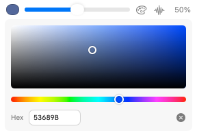

# OpenDisplay Lenovo

OpenDisplay Lenovo adds macOS controls for the rear light strip on the **Lenovo Legion Y34wz-30**. It is a personal fork of [aquitaine/OpenDisplay 0.11.8](https://github.com/aquitaine/OpenDisplay/tree/v0.11.8). Lenovo’s Windows utility can set individual strip colors. This fork brings that control into the same Mac menu that already handles display brightness and volume.



## Using the monitor

Connect the monitor’s **USB upstream data port** to the Mac as well as its video input. A USB-C connection that carries both works, or use HDMI/DisplayPort for video and a separate upstream USB cable. If the monitor’s hub is switched to a different computer, that computer owns the lighting controller.

| Control | What it does |
| --- | --- |
| Color swatch | Opens an inline picker. Drag to any color or type a six-digit hex value. The strip changes immediately. |
| Slider | Sets strip brightness independently of the display backlight. |
| Palette button | Recalls a built-in or saved six-zone palette. Create, name, edit, or delete palettes under **Settings → Displays → Lenovo Legion → Saved palettes**. |
| Waveform button | Selects steady light, moving effects, a custom wave, or an audio meter. The audio meter follows Mac playback and requires macOS 14.2 or later. |
| Lenovo Legion settings | Controls game mode, HDR and dynamic contrast over the video connection using DDC/CI. |

OpenDisplay’s existing display controls, CLI and recovery tools come from upstream. The fork adds support for one connected Y34wz-30. Keyboard routing stays with the physical KVM. Solid red, six simultaneous colors, a moving Marquee and playback-reactive lighting were confirmed on hardware. Zone orientation, persistence across sleep, and some picture modes remain unverified. [Protocol and hardware results](Docs/Compatibility/Lenovo-Y34wz-30.md)

## Install with Homebrew

Use an Apple Silicon Mac running macOS 14 or later, Homebrew and full Xcode 16 or later. Homebrew builds the reviewed source locally with Xcode. Quit any running copy of OpenDisplay before opening the fork. Both use the same app identifier and preference store.

```sh
brew tap guydada/display https://github.com/Guydada/OpenDisplay-Lenovo
brew install guydada/display/opendisplay-lenovo
open "$(brew --prefix opendisplay-lenovo)/libexec/OpenDisplay Lenovo.app"
```

If you are moving from the upstream Homebrew cask, first verify that the fork opens. Then run `brew uninstall --cask aquitaine/tap/opendisplay` to remove the previous app. A normal uninstall preserves the shared settings. The cask’s `--zap` option deletes them.

The formula also installs the `opendisplay-lenovo` CLI. These commands check the USB connection and preview a color report without changing the strip. Use the Lenovo selector from `opendisplay-lenovo list` if it is a secondary display.

```sh
opendisplay-lenovo lenovo main lighting-status
opendisplay-lenovo lenovo main color 123456 42 --dry-run
```

For updates, quit the app, run `brew update && brew upgrade opendisplay-lenovo`, then reopen it. To remove the package, use `brew uninstall opendisplay-lenovo`. The fork uses local ad hoc signing. macOS may ask again for feature permissions after an upgrade.

## Build and test from a checkout

```sh
git clone https://github.com/Guydada/OpenDisplay-Lenovo.git
cd OpenDisplay-Lenovo
brew install xcodegen
make test
scripts/build-lenovo-local.sh
scripts/test-lenovo-lighting.sh
open dist/OpenDisplay.app
```

The lighting tests use a simulated USB writer and isolated preferences. They exercise the exact report bytes, palette storage, effects, audio level handling, and the menu’s click-and-drag behavior. The AppKit test needs a logged-in macOS desktop.

## Project and privacy

This is a hardware-specific hobby fork, maintained as time permits. The public repository distributes source through Homebrew. Verification runs locally. Strip control uses the local USB device and the audio effect reduces playback samples to a volume level in memory. [Security policy and private reporting](SECURITY.md)

OpenDisplay and this fork are licensed under GPL-3.0-or-later. Credit for the display engine, app and recovery architecture belongs to the upstream contributors. The Lenovo picture controls use the published Y34wz-30 register reference. [License](LICENSE) · [Upstream OpenDisplay](https://github.com/aquitaine/OpenDisplay) · [Monitor register reference](https://github.com/Ferroman/lenovo-y34wz-cli/blob/28705fe98007a24f11d0eea9462b1c1228d02806/docs/reference.md)
